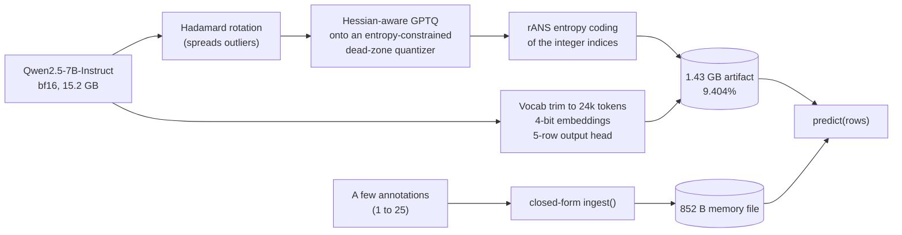

# The 10% Challenge: a 7B model in 1.4 GB

**Qwen2.5-7B-Instruct at 9.4% of its bf16 size, scoring higher than the original on a locked exam, and still able to learn from feedback.**

> This is our submission to the [10% challenge](https://github.com/DeusExperiments/ten-percent-challenge): keep about 10% of a trained model, match its score on an exam it never saw, and let it learn from a few user annotations, all without training the weights. The proof is filed as [issue #2](https://github.com/DeusExperiments/ten-percent-challenge/issues/2). The maintainer decides whether it counts.

## The result

Base: `Qwen/Qwen2.5-7B-Instruct` (7.6B parameters, 15.23 GB in bf16). Task: **C2, tool selection**: pick the right API among four confusable tools, or "none fits" (agentic tool use, 2000 locked items).

| | Base (bf16) | **Ours** |
|---|---|---|
| **Size on disk** | 15,231,233,024 B | **1,432,413,553 B (9.404%)** |
| **Locked exam, stage 1** | 0.7675 | **0.799** (+3.15 pts, paired 95% CI [+1.60, +4.70]) |
| **Locked exam, stage 2 (after feedback)** | 0.7675 | **0.802** (+3.45 pts, paired 95% CI [+1.85, +5.05]) |
| Non-inferiority (margin 1 pt, α 0.05) | n/a | passed both stages, p = 0.001 |
| Items where only one model is right | base 94-100 | ours 157-169 (McNemar p ≤ 8e-5) |

Every byte is counted: weights, scales, codebooks, indices, embedding rows, vocabulary map, tokenizer, config, loader code, the feedback head, and the feedback memory (852 bytes). The artifact directory had the **same tree hash at both stages** (`6290414d…`); only the memory file changed. The candidate ran in a sandbox with **no network and no Hugging Face cache**.

Receipts: [`stage1.json`](v2/harness/receipts/REAL_final/stage1.json) · [`stage2.json`](v2/harness/receipts/REAL_final/stage2.json) · write-up: [`v2/PROOF_C2.md`](v2/PROOF_C2.md)

## How it works

- **No weight training.** Compression is post-training: rotate the weights so outliers spread out, round them with a Hessian-aware method calibrated on a small calibration set, then entropy-code the integers. No gradient step on any task loss.
- **Tool selection is a tiny output problem.** The answer is one of five letters, so the output head shrinks to five rows and the vocabulary to 24,000 tokens chosen from calibration text. That frees a large share of the budget for the transformer body.
- **Feedback without training, without RAG.** A user marks the model's tool choices. `ingest()` folds them into per-tool running prototype means and (true, predicted) tallies in closed form. Nothing is stored or looked up, no prompt tokens change, no weights change. A new tool seen five times is recognized on unseen queries, and a confusable pair is fixed.

On the dev side (not the exam), the feedback gives: new-tool accuracy .855 → .927 after one annotation, 92-100% of unseen confusable-pair errors fixed, and no loss on unrelated items ([`v2/c2_fb/RESULTS.md`](v2/c2_fb/RESULTS.md)).

## The rules, one by one

| # | Rule | How we meet it |
|---|---|---|
| 1 | One trained model, over 0.5B, commercial-class task | Qwen2.5-7B-Instruct; tool selection, a maintainer-named example |
| 2 | About 10% of fp16, no weight training | 9.404%, all files counted, calibration-only compression |
| 3 | Match the base | Non-inferior at 1 pt on the same locked items, and higher in fact |
| 4 | Pass an exam it never saw | Hash-locked before building, single-use claim, run once per stage |
| 5 | Grow with few annotations | 852-byte memory, no retraining, no RAG, still passes the exam |

## What we do not claim

We want the weak points in plain sight.

- The margin is 1 point. This shows **non-inferiority**, not identical predictions; agreement with the base is about 0.86-0.89.
- The compressed model scoring *above* the base is probably tied to prompt sensitivity of the base's "none fits" decisions under a frozen zero-shot prompt. We do not claim it is more capable.
- Quantizer settings were chosen using dev scores among a handful of configs, so dev numbers are optimistic. The locked score is the unbiased one.
- The feedback head is a closed-form linear model fitted on labelled calibration items. A strict reading of "no training" could object. The fallback is plain argmax with no feedback.
- Decoding needs a GPU and about 3 minutes (rANS over 6.5B symbols), plus `torch`, `transformers==4.51.3` and `constriction`.
- Process incidents: two stand-in runs crashed on a corrupt local copy of the weights (fixed and re-hashed), and during harness development an agent accidentally printed 600 bytes of an unrelated, unused locked file. Both are in the proof write-up.

## What did not work

Our first target, a 14B model on broad knowledge (MMLU), hit a wall. No training-free method got near base accuracy at 10% of bf16:

| Approach (Qwen 14B / 30B MoE, MMLU dev) | Size | Score | Base |
|---|---|---|---|
| Rotation + GPTQ (scalar) | 9.7% | 0.52 | 0.80 |
| Vector quantization (lattice/k-means) | 9.6% | 0.62 | 0.80 |
| MoE expert pruning + 2-bit | 9.75% | 0.73 | 0.81 |
| Lossless entropy coding alone | 15.4% at 3-bit accuracy | 0.75 | 0.80 |

Broad knowledge needs far more than 1.6 bits per weight. A narrow output space (choose among five options) is what makes 10% reachable, and a native ternary model (BitNet-b1.58-2B, 9.5%) and a classification task (MDC-6, 7B at 9.74%) were verified as fallbacks. Details and the full list of dead ends: [`v2/`](v2/).

## Repo map

| Path | What is there |
|---|---|
| [`v2/PROOF_C2.md`](v2/PROOF_C2.md) | The proof write-up filed as issue #2 |
| [`v2/DECISION.md`](v2/DECISION.md) | Task, base, pass criterion, filing rule, **pre-registered before the exam** |
| [`v2/harness/`](v2/harness) | Lock, size gate, single-use remote exam runner, statistics, receipts, [runbook](v2/harness/RUNBOOK.md) |
| [`v2/commercial/`](v2/commercial) | Task suites (PII, AI-vs-human, tool use), hash locks, base scores |
| [`v2/compress_C/`](v2/compress_C), [`v2/altpush/`](v2/altpush) | The quantize, pack and verify pipeline |
| [`v2/c2_fb/`](v2/c2_fb) | Feedback head, `ingest()`, artifact manifest |
| [`v2/RULES.md`](v2/RULES.md) | The maintainer's rulings and how we read them |
| `v2/{engine,vq,moe,prune,entropy,big,lowbit}/` | Every approach we tried, with results and failures |
| `track*/` | Early exploratory work on a small BERT model (does not meet the 0.5B rule) |

## Reproduce

1. Download the artifact from the [release](https://github.com/Bobliuuu/ten-percent-challenge/releases/tag/c2-artifact-v1) into one empty directory, and check each file against [`v2/c2_fb/artifact_MANIFEST.json`](v2/c2_fb/artifact_MANIFEST.json).
2. Follow [`v2/harness/RUNBOOK.md`](v2/harness/RUNBOOK.md) to run the exam harness (needs a GPU and Modal).
3. The locked exam file `v2/commercial/C2/locked.jsonl` is in the repo and matches the hash in `v2/commercial/LOCK.json`. It was run once per stage; the receipts are the evidence. (It is public now, so it can no longer serve as an unseen exam for anyone else.)

## Built with

Most of this was built by a swarm of [Claude Code](https://claude.com/claude-code) agents working in parallel (quantization sweeps, harness, feedback design, rules scouting), coordinated by one lead session, with every result pushed to this repo as it landed.
