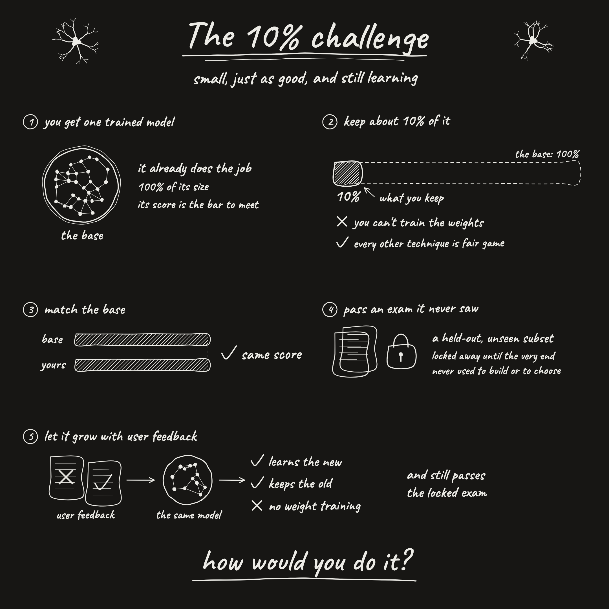
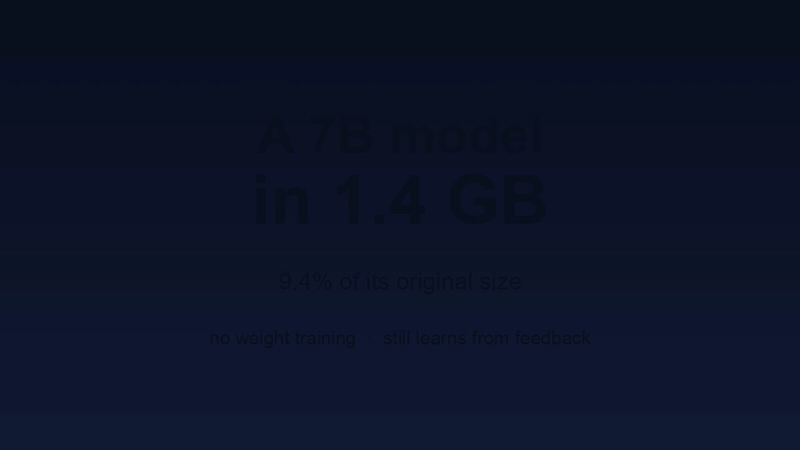
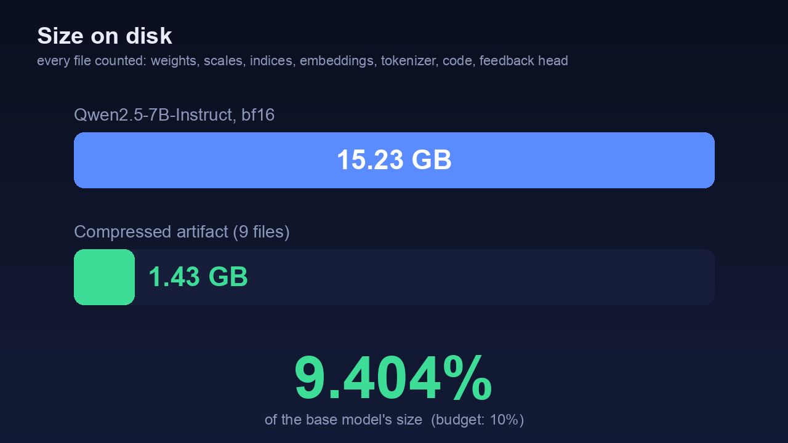
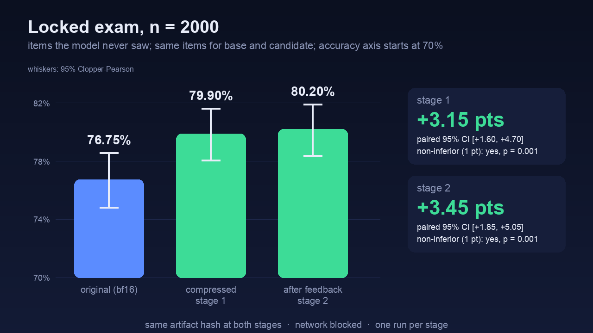
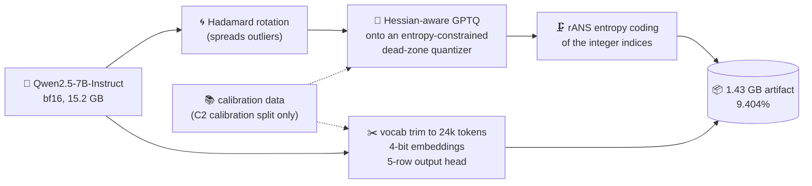
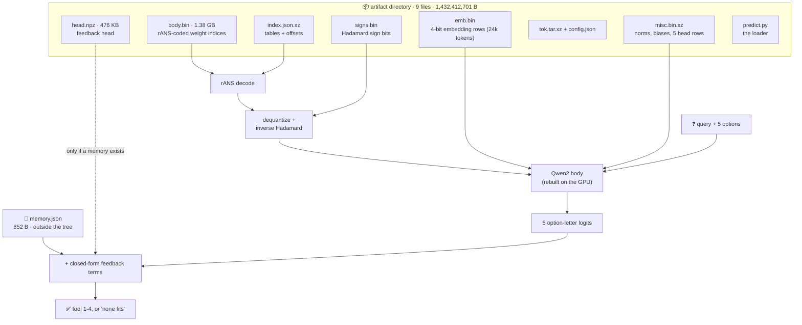
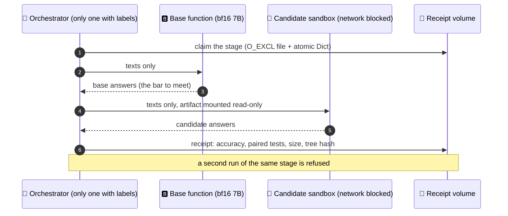
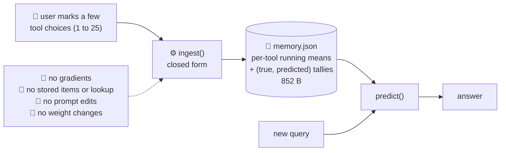
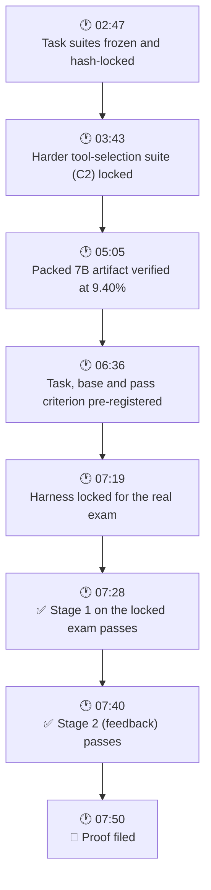
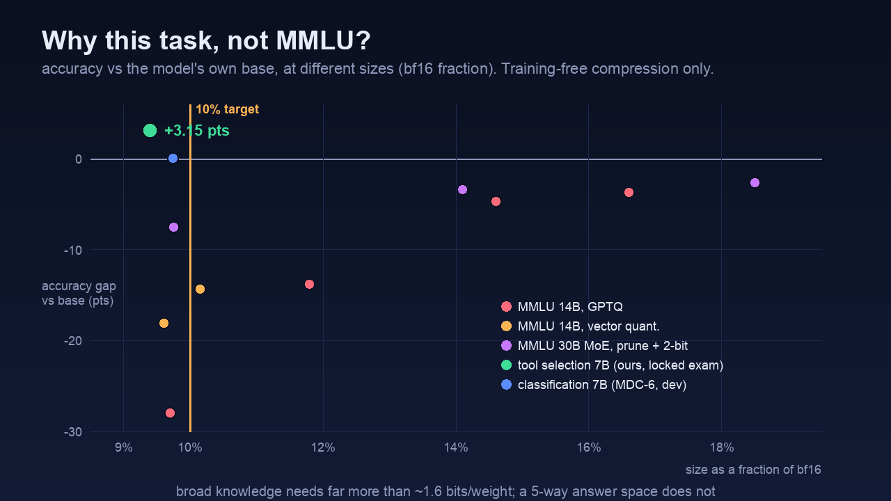

# 🗜️ The 10% Challenge
### A 7-billion-parameter model in **1.4 GB**, still learning

**Qwen2.5-7B-Instruct at 9.4% of its bf16 size, scoring *higher* than the original on a locked exam, and able to learn from a handful of user annotations. No weight training.**

[**📊 Result**](#-the-result) · [**🧭 Architecture**](#-architecture) · [**✅ Rules**](#-the-rules-one-by-one) · [**🧱 What failed**](#-what-did-not-work) · [**🔁 Reproduce**](#-reproduce)

> 🏁 This is our submission to the [10% challenge](https://github.com/DeusExperiments/ten-percent-challenge): keep about 10% of a trained model, match its score on an exam it never saw, and let it learn from a few user annotations, **without training the weights**. The proof is filed as [issue #2](https://github.com/DeusExperiments/ten-percent-challenge/issues/2). The maintainer decides whether it counts.

---

## Status and plan

The entry described below is filed as issue #2 and the maintainer has said its feedback step does not hold; measured against the nine judging rules in the upstream README it does not pass (rule 2: 93.9% of base-correct items kept on the locked exam against the required 98%; rule 4 and rule 7 as well). The description below is left unchanged as a record of what was submitted. Current work, everything we have tried (including negative results), the planned experiments, and an honest feasibility estimate before the 2026-11-12 17:05 UTC deadline are in:

- [`STATUS.md`](STATUS.md): one-page status, the maintainer's rulings, a rule-by-rule scoreboard of every approach, the full log of what was tried, what is next, and can-we-do-it-in-time
- [`v2/RULES.md`](v2/RULES.md): the rules and the maintainer's rulings, single source of truth
- [`v2/SOLUTIONS.md`](v2/SOLUTIONS.md): registry of every candidate and feedback mechanism
- [`v2/EXPERIMENT_QUEUE.md`](v2/EXPERIMENT_QUEUE.md): pre-registered next experiments X01-X15 with decision rules and budget

---

## 📊 The result

 🎞️ 16-second summary · <a href="assets/demo.mp4">MP4</a>

**Base:** `Qwen/Qwen2.5-7B-Instruct` (7.6B parameters, 15.23 GB in bf16). **Task C2, tool selection:** pick the right API among four confusable tools, or "none fits" 🛠️ (an agentic tool-use task, 2000 locked items).

| | Base (bf16) | ✨ **Ours** |
|---|---|---|
| 📦 **Size on disk** | 15,231,233,024 B | **1,432,413,553 B (9.404%)** |
| 🔒 **Locked exam, stage 1** | 0.7675 | **0.799** (+3.15 pts, paired 95% CI [+1.60, +4.70]) |
| 🧠 **Locked exam, stage 2 (after feedback)** | 0.7675 | **0.802** (+3.45 pts, paired 95% CI [+1.85, +5.05]) |
| ✅ **Non-inferiority** (margin 1 pt, α 0.05) | n/a | passed both stages, p = 0.001 |
| ⚖️ Items where only one model is right | base 94-100 | ours 157-169 (McNemar p ≤ 8e-5) |

 

Every byte is counted: weights, scales, codebooks, indices, embedding rows, vocabulary map, tokenizer, config, loader code, the feedback head, and the feedback memory (852 bytes). The artifact directory had the **same tree hash at both stages** (`6290414d…`); only the memory file changed. The candidate ran in a sandbox with **no network and no Hugging Face cache** 🔌.

🧾 Receipts: [`stage1.json`](v2/harness/receipts/REAL_final/stage1.json) · [`stage2.json`](v2/harness/receipts/REAL_final/stage2.json) · write-up: [`v2/PROOF_C2.md`](v2/PROOF_C2.md)

---

## 🧭 Architecture

### 1️⃣ Compression pipeline (post-training, no gradient steps)

### 2️⃣ What is inside the artifact, and how it runs

### 3️⃣ How the exam was kept honest

### 4️⃣ Feedback without training and without retrieval

> 🔬 **How it works, in plain words.** Compression is post-training: rotate the weights so outliers spread out, round them with a Hessian-aware method calibrated on a small calibration set, entropy-code the integers. Tool selection has only five possible answers, so the output head shrinks to five rows and the vocabulary to 24,000 tokens, which frees a large share of the budget for the transformer body. Feedback folds a user's annotations into per-tool running means in closed form: nothing is stored or looked up, and no weights or prompt tokens change.

On the dev side (not the exam), the feedback gives: new-tool accuracy .855 → .927 after one annotation, 92-100% of unseen confusable-pair errors fixed, and no loss on unrelated items ([`v2/c2_fb/RESULTS.md`](v2/c2_fb/RESULTS.md)).

📅 <b>Timeline of the proof (all 2026-11-06, EST)</b>

---

## ✅ The rules, one by one

| # | Rule | Status | How we meet it |
|---|---|---|---|
| 1 | One trained model, over 0.5B, commercial-class task | ✅ | Qwen2.5-7B-Instruct; tool selection, a maintainer-named example |
| 2 | About 10% of fp16, no weight training | ✅ | 9.404%, all files counted, calibration-only compression |
| 3 | Match the base | ✅ | Non-inferior at 1 pt on the same locked items, and higher in fact |
| 4 | Pass an exam it never saw | ✅ | Hash-locked before building, single-use claim, run once per stage |
| 5 | Grow with few annotations | ✅ | 852-byte memory, no retraining, no RAG, still passes the exam |

## 🧱 What did not work

Our first target, a 14B model on broad knowledge (MMLU), hit a wall. No training-free method got near base accuracy at 10% of bf16:

| Approach (Qwen 14B / 30B MoE, MMLU dev) | Size | Score | Base |
|---|---|---|---|
| 🎚️ Rotation + GPTQ (scalar) | 9.7% | 0.52 | 0.80 |
| 🧊 Vector quantization (lattice / k-means) | 9.6% | 0.62 | 0.80 |
| 🧩 MoE expert pruning + 2-bit | 9.75% | 0.73 | 0.81 |
| 📉 Lossless entropy coding alone | 15.4% at 3-bit accuracy | 0.75 | 0.80 |

💡 Broad knowledge needs far more than 1.6 bits per weight. A narrow output space (choose among five options) is what makes 10% reachable. A native ternary model (BitNet-b1.58-2B, 9.5%) and a classification task (MDC-6, 7B at 9.74%) were verified as fallbacks. Full list of dead ends: [`v2/`](v2/).

---

## 🗺️ Repo map

| Path | What is there |
|---|---|
| 📄 [`v2/PROOF_C2.md`](v2/PROOF_C2.md) | The proof write-up filed as issue #2 |
| 🧭 [`v2/DECISION.md`](v2/DECISION.md) | Task, base, pass criterion, filing rule, **pre-registered before the exam** |
| 🧪 [`v2/harness/`](v2/harness) | Lock, size gate, single-use remote exam runner, statistics, receipts, [runbook](v2/harness/RUNBOOK.md) |
| 🛠️ [`v2/commercial/`](v2/commercial) | Task suites (PII, AI-vs-human, tool use), hash locks, base scores |
| 🗜️ [`v2/compress_C/`](v2/compress_C), [`v2/altpush/`](v2/altpush) | The quantize, pack and verify pipeline |
| 🧠 [`v2/c2_fb/`](v2/c2_fb) | Feedback head, `ingest()`, artifact manifest |
| 📜 [`v2/RULES.md`](v2/RULES.md) | The maintainer's rulings and how we read them |
| 🪦 `v2/{engine,vq,moe,prune,entropy,big,lowbit}/` | Every approach we tried, with results and failures |
| 🕰️ `track*/` | Early exploratory work on a small BERT model (does not meet the 0.5B rule) |

## 🔁 Reproduce

1. 📥 Download the artifact from the [release](https://github.com/Bobliuuu/ten-percent-challenge/releases/tag/c2-artifact-v1) into one empty directory, and check each file against [`v2/c2_fb/artifact_MANIFEST.json`](v2/c2_fb/artifact_MANIFEST.json).
2. ▶️ Follow [`v2/harness/RUNBOOK.md`](v2/harness/RUNBOOK.md) to run the exam harness (needs a GPU and Modal).
3. 🔒 The locked exam file `v2/commercial/C2/locked.jsonl` is in the repo and matches the hash in `v2/commercial/LOCK.json`. It was run once per stage; the receipts are the evidence.

## 🤖 Built with

Most of this was built by a swarm of [Claude Code](https://claude.com/claude-code) agents working in parallel (quantization sweeps, harness, feedback design, rules scouting), coordinated by one lead session, with every result pushed to this repo as it landed.
