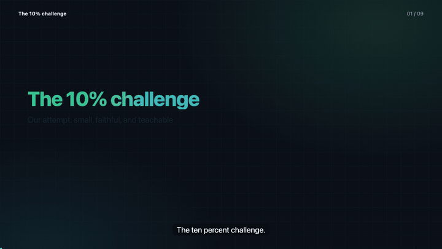
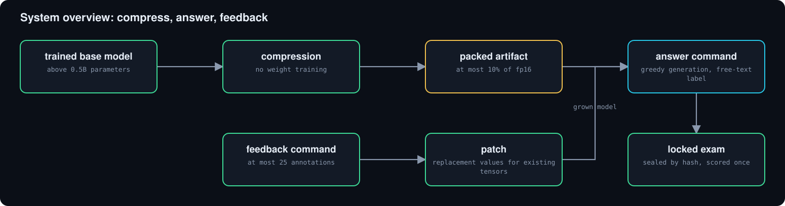
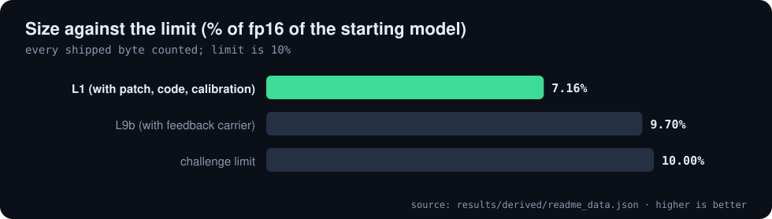
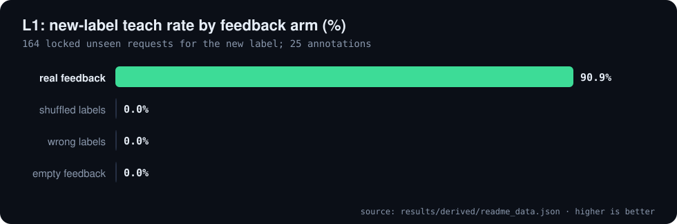
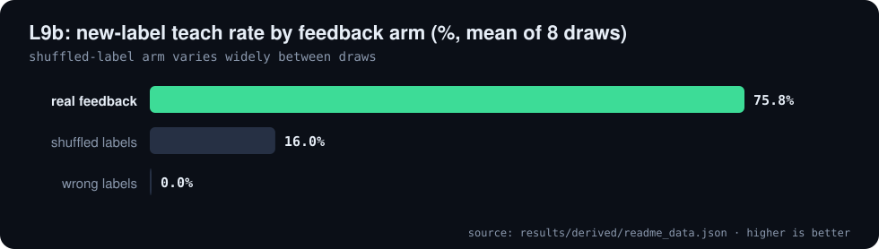

<div align="center">



# 🌳 The 10% challenge

**Our attempt: shrink a trained model below 10% of its fp16 size, keep its behaviour on an unseen exam, and teach it a new label from at most 25 corrections**

[](https://github.com/DeusExperiments/ten-percent-challenge/issues/2)   [](https://github.com/Bobliuuu/ten-percent-challenge/releases/tag/v0.1.0) [](https://huggingface.co/Bobliu/tenpct-l1-bonsai8b-grow)

[🎬 Video](#video) · [📋 Summary](#summary) · [🥇 L1](#l1) · [🥈 L9b](#l9b) · [⚠️ Limitations](#caveats) · [🔁 Reproduce](#reproduce) · [🗺️ Repo map](#repo-map)

</div>

---

**Explainer video (voice-over and subtitles): the challenge, the two entries, and the numbers with their caveats**

[](video/tenpct_explainer.mp4)

<a id="video"></a>
The [10% challenge](https://github.com/DeusExperiments/ten-percent-challenge) asks for a model that is at most 10% of the size of a trained model, behaves the same as that model on an exam it never saw,
and can learn from a few user corrections, all without training the weights. This repo is our working record: code, exams, results.

Our task is 7-way voice-skill routing ("which skill should handle this request?") on a locked exam of 2,744 items. The model writes a real word as its answer (greedy decoding, exact string match; no multiple choice).
A new label (for example `Recipe`) is taught from at most 25 corrections by a one-shot closed-form calculation that edits some **existing** weights: no head, adapter, lookup table or prompt.

> **Status, as stated in the repo.** Filed entry: **L1**, [issue #2](https://github.com/DeusExperiments/ten-percent-challenge/issues/2). It passes all 9 judging rules **under our reading**; three of those passes rest on readings the maintainer has not ruled on.
> Numbers below are read from the lanes' result files; nothing was re-run for this page.

<a id="summary"></a>

## 📋 Summary and status

1. We shrink big models to under 10% of their fp16 size and score them on a locked exam of 2,744 items (7-way voice-skill routing).
2. The model writes a real word as its answer (greedy decoding, exact string match; no multiple choice, no constrained decoding).
3. We teach a new label from at most 25 corrections by a one-shot closed-form calculation that edits some **existing** weights. The model's own forward pass writes the new word.
4. **The filed entry (L1) passes all 9 judging rules under our reading** (see [issue #2](https://github.com/DeusExperiments/ten-percent-challenge/issues/2)). Three of those passes rest on readings the maintainer has not ruled on:
   - **Rule 2** is measured against Bonsai-8B, the released model the entry starts from (1.000); against its fp16 ancestor Qwen3-8B, retention is 88.9% on dev data.
   - **Rule 4:** feedback is a closed-form edit of existing weights (no head, adapter, lookup, prompt or new tensor), computed from the annotations.
   - **Rule 9:** rule 1 allows a model "before or after you cut it"; the 1-bit compression is the release's makers' work, not ours.
5. Other lanes keep their own verdicts in [docs/FULL_ATTEMPT_RECORD.md](docs/FULL_ATTEMPT_RECORD.md) (GRAY where a reading decides them).

| rule | in a few words |
|---|---|
| 1 | size counts every shipped byte, against the fp16 size of the starting model |
| 2 | keep at least 98% of what the original got right, and at least 95% in every kind |
| 3 | exam is unseen: at least 2,000 items, 300 per kind, 500 from a source never used |
| 4 | no new trained parts (no heads, adapters, side memory, feedback in the prompt) |
| 5 | feedback must teach: at most 25 annotations, 25+ locked teach items, clear improvement, neighbours kept |
| 6 | shuffled-label and empty feedback must do clearly worse |
| 7 | the model keeps the task's real output (no multiple-choice stand-in) |
| 8 | the original must have something to keep (well above chance, below its ceiling) |
| 9 | spirit over letter: readings that defeat the purpose are rejected |

The rules are copied word for word in [`v2/RULES.md`](v2/RULES.md). Current status and the candidate table: [`STATUS.md`](STATUS.md).

<p align="center"></p>

<a id="l1"></a>

## 🥇 L1 (primary): Bonsai-8B plus a closed-form feedback patch

**What it is.** Bonsai-8B, a 1-bit release built from Qwen3-8B by its makers, repacked losslessly (outputs identical to the release). We did no compression of our own here.
Feedback: closed-form edit of the existing per-128-group scales of the 1-bit MLP `down_proj` in the last 6 layers (default `scale` carrier, no new tensor).

**L1 end to end through the shipped commands (v2/lanes/L1/results/e2e_locked_scale_default.json)**

| feedback arm | new-label teach (%) |
| :--- | ---: |
| real feedback | 90.9 |
| shuffled labels | 0.0 |
| wrong labels | 0.0 |
| empty feedback | 0.0 |

<sub>Source: `results/derived/readme_data.json`</sub>

<p align="center"></p>

<p align="center"></p>

<details>
<summary>L1 weaknesses (from the lane report)</summary>

- Second task BANK6: exam retention 1.000 but `Security` teach only .727, shuffled .10 (one draw .49).
- A new skill close to an old one steals old items: Alarm-to-Timer flips 21.7%; Email vs Lists in continual mode drops neighbours to .86.
- One narrow task with seven labels; the base is near its ceiling on several cells.
- The shuffled-label control damaged the exam in one measurement (retention .9783, below our 98% gate; `cols` not measured on that arm).
- The three real `Timer` draws coincide to the last digit (8 templates): one measurement.

</details>

Size 7.16% of Qwen3-8B fp16 counting patch (4.7 MB), code, calibration prompts, tensor manifest and licence. Exam accuracy of the base 90.7%. Teach 90.9%, neighbours kept 99.7%; shuffled 0.0%, wrong 0.0%, empty 0.0% (the empty-feedback tree is byte-identical to the release).

**How to run** (one CUDA GPU of about 17 GB, `torch`, `transformers==4.56.2`; folder [`v2/lanes/L1`](v2/lanes/L1/); weights: [Hugging Face artifact](https://huggingface.co/Bobliu/tenpct-l1-bonsai8b-grow)):

```
python answer.py --artifact <DIR> --task skill_task.json "wake me at six" "play some jazz"
python feedback.py --artifact <DIR> --task skill_task.json --ann ann.jsonl     # rows: {"text": "...", "label": "Recipe"}, at most 25
python answer.py --artifact <DIR> --task skill_task.json --feedback ann.jsonl "how long do I boil an egg"
```
An empty `ann.jsonl` removes the patch and restores the release byte for byte. Detail: [`v2/lanes/L1/REPORT.md`](v2/lanes/L1/REPORT.md).

<a id="l9b"></a>

## 🥈 L9b (alternate): Qwen3.5-35B-A3B, pruned and 3-bit, our own compression

**What it is.** Qwen3.5-35B-A3B (an unmodified full-precision release). We keep 102 of 256 experts per layer (chosen by routing mass on unlabeled task prompts), 3-bit RTN on kept experts, 6-bit attention and shared expert, 4-bit embedding and output layer; the vision tower is not shipped.
Feedback: closed-form edit of the shared-expert `down_proj` columns of the last 10 MoE layers, stored as replacement columns.

**L9b, 8 feedback draws, mean (v2/lanes/L9b/results/fb_locked8.json)**

| feedback arm | new-label teach, mean (%) |
| :--- | ---: |
| real feedback | 75.8 |
| shuffled labels | 16.0 |
| wrong labels | 0.0 |

<sub>Source: `results/derived/readme_data.json`</sub>

<p align="center"></p>

Size 9.67% on the packed file, 9.70% with the feedback carrier (text-only fp16 reference). Retention against the original 99.47% to 99.55% across three quantizer draws; teach 75.8% mean over 8 draws, shuffled 16.0% mean (up to 39.6% on a bad draw), wrong 0.0%; neighbours 98.2%.
Detail: [`v2/lanes/L9b/REPORT.md`](v2/lanes/L9b/REPORT.md). Other lanes (L2 to L14) and the failed ones are in [docs/FULL_ATTEMPT_RECORD.md](docs/FULL_ATTEMPT_RECORD.md) and [`v2/WHAT_WE_TRIED.md`](v2/WHAT_WE_TRIED.md).

<a id="reproduce"></a>

## 🔁 Reproduce

Large artifacts are not stored in git; each is rebuilt from the public base-model snapshot with its lane's pack scripts. The shared exam loads with `python3 -I v2/exam/loader.py`.

```bash
python3 tools/readme_data.py                              # lane result files -> results/derived/readme_data.json
python3 ~/video-readme-maker/vrm.py all README.spec.yml   # README.md, assets/, video/
```

| what | where |
|---|---|
| current status and candidate table | [`STATUS.md`](STATUS.md) |
| rules, word for word | [`v2/RULES.md`](v2/RULES.md), [`GOAL_README.md`](GOAL_README.md) |
| which entry to file | [`v2/ENTRY_DECISION.md`](v2/ENTRY_DECISION.md) |
| lane reports, manifests, raw results | `v2/lanes/L1`, `L9b`, ... (each `REPORT.md`, `MANIFEST.json`, `results/`) |
| filing drafts | [`v2/FILING/`](v2/FILING/) |
| shared locked exam | `v2/exam/` |

<a id="caveats"></a>

## ⚠️ Honest caveats

- **The exam is ours.** 2,744 items from public data, sealed by hash before any run and scored once; it is not the maintainer's exam. 532 rows are flagged `seen_tox`.
- **L1 starts from a released 1-bit model** (Bonsai-8B); the compression is its makers' work, and retention against the fp16 ancestor Qwen3-8B is 88.9% on dev data.
- **Three of L1's nine passes rest on readings nobody has ruled on** (rules 2, 4 and 9).
- **One narrow task with seven labels**; the base is near its ceiling on several cells.
- **L9b is the alternate** (not the filed entry): its shuffled-label control varies widely between draws, and the quantised artifact is regenerated from the public model.

<a id="repo-map"></a>

## 🗺️ Repo map

| Path | What it is |
|---|---|
| `v2/lanes/L1/` | primary entry: Bonsai-8B repack, answer and feedback commands, results |
| `v2/lanes/L9b/` | alternate entry: pruned 3-bit Qwen3.5-35B-A3B, packer, results |
| `v2/exam/` | shared locked exam, plan, hashes, loader |
| `v2/FILING/` | filing drafts and checklists |
| `STATUS.md` | current status and candidate table |
| `docs/FULL_ATTEMPT_RECORD.md` | previous full README with every lane, verdict tables and architecture diagrams |
| `tools/readme_data.py` | derives README and video numbers from lane result files |
| `README.spec.yml` | spec for video-readme-maker |
| `video/` | explainer mp4, srt, poster, preview gif (generated) |

---

<div align="center"><sub>Generated with video-readme-maker from README.spec.yml and the lanes' result files.</sub></div>
